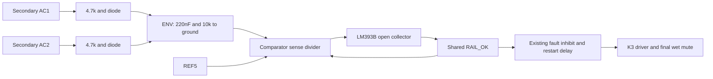

# Secondary-loss detector — candidate, not native

Owner: Renegade integration. Task card: use the VAL-051 loaded secondary/rectifier decks at baseline75b5363 to screen advance mute. Deliver contracts, reproducible simulations, independent checks and exact component evidence. No CAD mutation. Done for this screening step means retained failures, source hashes and independent replay; hardware qualification additionally requires actual contact timing, power sequencing and exact sourced assemblies.

## Circuit and interfaces

Each auxiliary secondary endpoint AC1/AC2 feeds its own4.7kΩ resistor and onsemi1N4148TR anode. Cathodes join AC_ENV;220nF film and10kΩ bleed connect ENV to ground. This senses only the isolated low-voltage secondary. Comparator positive input connects to ENV through220kΩ, ground through22kΩ, shared RAIL_OK through8.2MΩ and REF5 through1MΩ. Negative input uses24kΩ/1kΩ from REF5 to ground. The1MΩ bias keeps the modeled positive input above ground after excitation disappears while REF5 remains powered.

An additional LM393BIDR package, powered from+12V with local100nF bypass, pulls down the existing candidate RAIL_OK. Reuse its1.5kΩ REF5 pullup. Unused comparator: positive to ground, negative to REF5, output open. Its removable carrier/socket is required but not selected. The candidate reference bleeder changes8.2kΩ→7.5kΩ; no native value changes. REV_Q, the direct inhibit and delayed restart remain distinct functional interfaces.

## Completed evidence

84 integrated power-loss/steady cases plus two half-timestep repeats retain explicit PWL diode and leakage sensitivities.72 are permanent cutoffs.1,024 threshold corners give enable0.914–1.388V, disable0.788–1.268V and at least0.101V same-corner hysteresis. The tested healthy waveform margin is at least0.622V; no ordinary zero-crossing trips occur in those cases. Maximum detection delay is7.839ms including a provisional10µs comparator allowance.

Minimum remaining shutdown reserve is3.735ms **after** subtracting the prior13.947ms time-to-5%-coil-current screen and an additional5ms contact/logic allowance. Neither is a guaranteed mechanical contact specification. Maximum sampled diode reverse voltage is55.05V; sampled forward peak3.05mA. Sense input remains0.088–2.043V with REF5 powered.

48 finite interruptions (0.1/1/5/10/20/50ms, two mains modes, two phases, two front-end profiles) and two half-step repeats are retained. Four cases lose the documented raw headroom, and all four request inhibition early enough for the conditional mute allowance; minimum remaining reserve is6.810ms, with the fault still asserted when headroom is first lost. Five cases have a fault pulse shorter than2ms, so the existing delay analysis cannot establish a complete50ms restart hold; all five retain raw headroom. One restore case shows a second brief assertion in an enclosing threshold trace. No claim of chatter-free or quiet recovery follows. The interruption report also records the timing reserve before first raw headroom loss; inspect every affected trace, not merely the existence of a fault request.

Independent checks solve2,000 nodal cases (maximum difference8.9e-16V), replay two RC envelopes using independent RK4 branch-current integration (maximum deviations0.239/0.179mV), reject four deliberately corrupted reports and preserve22 native CAD files. The replay shares recorded loaded secondary waveforms and initial conditions; it is not an independent transformer model.

Combined static interface budget: REF5 load≤9.852mA against the10mA allocation, RAIL_OK high≥4.839V, sink≤3.472mA. Conditional passive reference-off RAIL_OK is0.819V with the7.5k bleeder versus0.873V with8.2k. This calculation excludes semiconductor backfeed/power sequencing and cannot qualify startup. Precision-monitor14 conditional checks still pass.

## Exact sources and purchasing limits

Dated source observations and PDF hashes live in [source-observations.json](results/ac-loss/source-observations.json).

| Candidate | Chinese listing observation, November25 | Outstanding |
|---|---|---|
| onsemi1N4148TR, C84410 | [LCSC China](https://item.szlcsc.com/85580.html),77,419 stock; raw minimum1/pack ratio50 | Treat50 as provisional physical purchase quantity; hot reverse leakage across actual voltage remains unqualified |
| KNSCHA82CL0125, C5359306 | [LCSC China](https://item.szlcsc.com/6172082.html),685 stock; minimum1/ratio5 |220nF±5%,63V,5mm pitch; model±20%/1GΩ are allocations, not continuous-hot guarantees |
| TI LM393BIDR, C2865059 | [LCSC China](https://item.szlcsc.com/3069736.html),98,236 stock; minimum1/ratio5 | Exact removable carrier/socket, bypass placement and pin mapping |

Manufacturer diode data: [onsemi](https://www.onsemi.com/pdf/datasheet/1n914-d.pdf), September2024 rev6.100V repetitive reverse rating;1V maximum at10mA/25°C.50µA reverse leakage at20V/150°C does not guarantee the modeled leakage at55V. Manufacturer capacitor approval is retained as an original supplier-hosted PDF: body7.2×6.5×2.5mm±0.5, lead0.5±0.05mm, pitch5±0.5mm. Room-temperature insulation and post-cooling endurance tests cannot replace operating-temperature qualification.

Exact resistor SKUs, additional socket hardware, delivered Shanghai cost and address-specific delivery are pending. Listings are not orders or reserved stock. No supplier contact, purchase or fabrication upload occurred.

## Next gates

1. Slow brownout and actual shared REF5/RAIL_OK/logic startup and collapse, including backfeed and threshold common-mode validity.
2. Actual relay contact closure and driver/clamp behavior, plus audio disturbance and complete restart after brief faults.
3. Exact transformer, reservoir, resistors, sockets and thermal solution; the50VA reference is not China-purchase-ready.
4. Only then carry qualified choices into readable native schematics/PCB, rerun electrical checks and populated three-board fit. Preserve removable back and tool access. All six scopes remain open.

Human check: on the eventual isolated secondary supply, measure ENV, REF5, RAIL_OK, both regulated rails and actual K3 contact timing together during startup, interruption and brownout at relevant load/temperature. Scope traces must establish timing and quiet recovery; software completion alone cannot.
