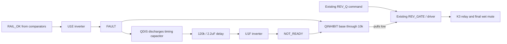

# Reverb fault-inhibit delay candidate

Owner: control-switching integration. Input revision19f45a8 and the buffered rail-monitor contract. Output: an editable timing contract, bounded calculation and source record. This checkpoint checks feasibility and exposes short-fault behavior; it does not adopt components or change native CAD. Estimated computation is seconds; hardware timing and hot-part validation remain external evidence.

The candidate preserves the user latch, existing relay driver and audio blocks. Both spare gates of the existing socketed SN74HC14N are used. No socket exception is proposed.

The two inhibit inputs each have their own10k resistor. The base-current calculation includes the other input being LOW, which loads the HIGH input. FAULT also drives QDIS through1k; its collector discharges DELAY through220Ω. A100k base-emitter resistor is fitted to each transistor. The timing capacitor is separate from the comparator hysteresis node. Exact connection and pin details are owned by [rail-delay-contract.json](rail-delay-contract.json).

Native boundary correction: R341 is still1k in the source, schematic and PCB. The candidate requires an unadopted4.7k replacement. A read-only three-file guard now verifies that boundary; retaining1k fails the proposed base-drive allocation. See [coil/driver follow-up](relay-latency-review.md). The native circuit was not changed by the earlier timing calculation.

## Calculation and short-fault result

The factory enumerates192 valid combinations of supply, resistor/capacitor endpoints, leakage, saturation and Schmitt thresholds. Impossible rising/falling threshold pairs are excluded; enclosing extrema remain. An independent branch-current RK4 integration checks384 charge/discharge crossings against the closed-form result within1ppm. This verifies the calculation for its stated model; it does not validate transistor, comparator or relay behavior.

Ten conditional arithmetic/logic screens pass. **The separate short-fault hold screen fails.** Qualification is false and the report retains that failure explicitly.

| Conditional result | Range |
|---|---:|
| Enable delay after a settled fault |54.650–864.386ms|
| RC discharge to falling Schmitt threshold |0.131–1.355ms|

| Fault duration | Timer asserts, out of192 cases | Cases with less than50ms recovery hold |
|---|---:|---:|
|0.1ms|0|192|
|0.5ms|64|128|
|1ms|148|56|
|2ms|192|0|
|5ms|192|0|

A falling-threshold crossing is not equivalent to fully restarting the nominal delay. At1ms, twelve cases assert the timer but still produce less than50ms hold. The direct FAULT path inhibits the driver independently of capacitor discharge, subject to actual comparator/logic/transistor delays. Mechanical contact release and audio transients are not calculated here. A50ms hold after every arbitrarily short pulse has not been justified as an audio requirement; the next full-circuit check must establish which rail disturbances can reach the audio path before adding a latch or faster muting stage.

## Manufacturer limits and sourcing

The source record contains PDFs, hashes, URLs and dated raw supplier fields: [rail-delay-sources.json](results/rail-delay-sources.json).

- TI SN74HC14 RevL page5 gives full-temperature thresholds at4.5V and6V, input leakage and4mA output limits. Using their outer threshold envelope over4.75–5.25V is an explicit engineering assumption, not a guaranteed intermediate-supply interpolation.
- Diodes MMBT3904 Rev27-2 gives saturation and leakage tests at25°C unless otherwise noted. The proposed0.4V saturation,1.2V base-emitter maximum and1µA hot off-leakage are allocations awaiting evidence. The3.84V HC14 load-line check cannot turn those allocations into manufacturer guarantees.
- KNSCHA82CL0117/C5359298 is a2.2µF5%100V film candidate. Its [domestic listing](https://item.szlcsc.com/6172074.html) reports356 pieces and minimum1 on2026-11-25. Its nominal body is7.2×11×6mm, each±0.5mm; leads0.6±0.05mm, pitch5±0.5mm. These dimensions are not yet adopted into a footprint or drill file.
- The KNSCHA approval document gives initial RC≥1000s at20°C/10V. Heat, humidity and solder tests specify changes after cooling, including8%,10% and3% capacitance change respectively. They do not prove continuous hot behavior or a combined lifetime bound. The20% total-capacitance and50nA film-leakage allocations remain unqualified.
- The proposed33k precision resistor TNPW080533K0BEEA/C844066 has stockNumber0 and validStockNumber0 in its [domestic listing](https://item.szlcsc.com/903640.html). A catalog page is insufficient purchasing evidence. No generic resistor inherits its temperature/endurance budget.
- Diodes MMBT3904-7-F has an LCSC catalog identity C94514, but its domestic stock/ordering route has not been established here. PCN2549 concerns discontinued Lite-On parts and identifies this Diodes part as a replacement; it is not evidence that the Diodes part is discontinued.

No order or supplier message was sent. Shanghai address-specific checkout remains unverified. The existing comparator and IC socket requirements remain unchanged.

## Next gate and reproduction

Run `python3 engineering/whole-amp/control-switching/tools/rail_delay_budget.py`. It reads only its contract and writes the current results JSON; it never regenerates native CAD. Known short-pulse limitations remain separate from the passing calculation screens.

Next: connect the candidate to the existing rail/reset/driver model, including coil/flyback and audio behavior, to determine whether brief dips require stored inhibit. Qualify the exact stocked precision network and hot component allocations before native capture. Then apply schematic preservation, ERC/DRC, socket/footprint, current-capacity and populated chassis checks. The removable back and actual tool-access requirements remain open; all six project scopes remain active.

Human check: measure rail thresholds and K3 contact timing on the actual assembly with the selected coil clamp, harness and component temperatures. Confirm return-to-panel and user-OFF priority during supply disturbances. Simulation is not evidence of silent physical switching.
