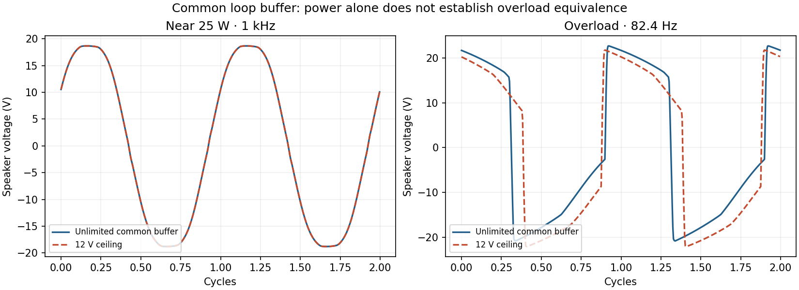

# Common loop buffer: normal power and overload are separate requirements

2026-11-25. Authority: DEC-016 common buffered path before the spring split, with mix recalibration. Baseline: `f3d258d`. **No native adoption or manufacturing release.** This pass rejects a shortcut on headroom; it does not undo the approved buffered-loop choice.

## Circuit and test boundary

The comparator is an ideal unity common buffer with 1 MΩ input and 1 kΩ output resistance. Both comparisons use the same current preamps, spring-send divider, passive mix, PI and output stage. The alternatives impose a symmetric 10 V or 12 V ceiling on that buffer's output. They are architecture probes, not models of a selected low-voltage amplifier. A real part's swing, slew, overload recovery, current limit, noise and rail faults remain separate requirements.

The existing reciprocal tapped-transformer fixture uses 40 H primary magnetizing inductance, 20 mH leakage, 250 pF primary capacitance, 0.2 Ω secondary copper and 8 Ω resistive load. Presence is 0.5. Supplies are stiff 400 V main / 380 V screen / −40 V bias / 278 V early / 313 V preamp. Generic tube models and their existing documented numerical domain guard are retained. These are declared experiments, not selected magnetics or hardware ratings.

Eight scenarios at 82.4 Hz, 1 kHz and 5 kHz produce 24 base runs. Full volume/master, tone and gain fractions 0.5 are electrical settings, not knob rotation. Clean stimuli are 6.72 mV or 100 mV peak; dirty stimuli are 10 mV or 100 mV peak. Each run lasts at least 0.5 seconds. The last ten cycles supply waveform and harmonic metrics; the preceding ten check settled amplitude. This is not exhaustive controls, 20 kHz or burst-recovery coverage.

Four 5 kHz runs initially exceeded the 90-second wall limit. All four completed in 105–147 seconds with a 300-second allowance, **without changing the deck, 0.5-second simulated duration, maximum timestep, integration method or tolerances**. Original timeout receipts/logs remain. These were runtime-limit failures, not evidence of circuit instability. Three half-timestep bass repeats and two additional near-25 W probes bring the completed set to 29 runs, from 33 attempts.

## Normal output-power evidence

The additional 1 kHz clean probe uses 9 mV pickup input, full volume and the same loaded-transformer fixture:

| Buffer | Fundamental load power | Speaker THD, harmonics 2–10 | Internal FX_SEND peak |
|---|---:|---:|---:|
| Unlimited comparison | 25.7134 W | 6.60193% | 4.2761 V |
| 12 V ceiling | 25.7125 W | 6.60151% | 4.2763 V |

The ceiling is not reached in this case. Thus the historical 135 V deep-overload excursion must not be called a normal clean RETURN requirement. Conversely, this is **not** 25 W at 1% THD, a hardware power rating, or proof that a 12 V ceiling preserves the instrument's overdrive. The earlier scenario named `clean-near-target` used a historical input estimate and actually produces 17.39 W in this fixture; the separate `clean-25w-probe` is the relevant approximate-power result.

## Overload evidence and decision

Fourteen of sixteen ceiling comparisons fail the declared preservation screen (±0.5 dB fundamental, ±1 percentage point THD and at most 5% normalized waveform RMS error). All compared runs meet the 1% successive-window amplitude-settling screen. Representative 12 V results, relative to the matched unlimited common buffer:

| Scenario | Fundamental change | THD change, percentage points | Waveform RMS error / reference RMS |
|---|---:|---:|---:|
| Clean overload, 1 kHz | +0.311 dB | −3.651 | 41.13% |
| Dirty, 10 mV input, 1 kHz | +0.276 dB | −2.614 | 25.76% |
| Clean overload, 82.4 Hz | +0.382 dB | −6.088 | 53.61% |
| Clean overload, 5 kHz | +0.570 dB | −6.870 | 44.13% |

Waveforms are compared at equal source phase without an artificial time shift. The change includes clipping duty/phase and downstream nonlinear response. Lower THD in an overdriven guitar amp is not automatically a transparent improvement. This model comparison does not predict perceived sound, but it is enough to reject adopting the 10/12 V ceiling merely because it can reach the target wattage.

The refined 82.4 Hz cases change power by at most 0.00248% and THD by 0.00232 percentage points. Those numerical differences are much smaller than the observed overload change. The independent least-squares harmonic audit agrees with the producer's FFT metrics within 3.14e−10 in the compared power/THD units. Three deliberately invalid evidence records are rejected. Source, native-board, deck and waveform hashes are checked; no circuit, connector, PCB, mounting or block ownership changed.

**Engineering disposition:** keep a higher-headroom recovery path at the approved insertion point. Next evaluate a discrete high-voltage gain/follower return powered from existing B+, including device spread, loading, stability, coupling/protection and thermal limits. The expensive three-OPA462 bootstrap remains a simulation reference, not the chosen implementation. Do not treat an ideal limiter as a selected socketed IC or alter the distortion behavior silently to obtain passing tests.

## Sourcing and remaining work

The [Microchip LND150/LND250 datasheet](https://www.microchip.com/content/dam/mchp/documents/OTH/ProductDocuments/DataSheets/LND150-LND250-N-Channel-Depletion-Mode-DMOS-FETs-Data-Sheet-20005454A.pdf) supports investigating a 500 V depletion device with a TO-92 option. A voltage rating alone does not establish audio gain, bias, bandwidth or a safe operating point. The [exact Chinese LND150N3-G-P003/C629120 listing](https://item.szlcsc.com/658919.html) remains a sourcing lead: direct retrieval failed this pass, and indexed alternatives are not accepted as current own-item stock/MOQ evidence. No new part is selected or claimed Shanghai-orderable.

The [Tube-Town two-LND150 module manual](https://media.tubetown.net/info/datenblaetter/kits/kit-fxloop150-RevD-EN.pdf), page 7, specifies at most 40 Vpp at its higher-level input. It therefore is not a proven drop-in for this amplifier's deep-overload envelope. It is precedent for investigating inexpensive discrete stages, not a qualified substitute.

In parallel with that specific design, K3's wet-contact fault exposure needs a targeted clamp/protection solution (VAL-065); a larger connector alone cannot protect the relay. Exact Chinese procurement, insulated harnesses, all-board voltage/current routing, the populated three-board chassis and actual drill/body/bit clearance remain open. Preserve current functional blocks and the removable wooden back. All six requested scopes remain incomplete.

## Reproduction

Use KiCad's bundled Python for `tools/run.py`, then `tools/retry.py` after the base process is terminal, `tools/run.py --refine clean-bass`, and `tools/target.py`. Retry operates only on recorded timeouts and preserves the first attempt. `tools/audit.py` uses NumPy; `tools/plot.py` additionally uses Matplotlib and reads only saved samples. Re-runs overwrite their case products, rather than accumulating complete copies. Public numerical evidence: [audit](results/audit.json), [base results](results/summary.json), [retry receipt](results/retry.json), [refinement](results/refinement.json) and [power probe](results/target.json).
