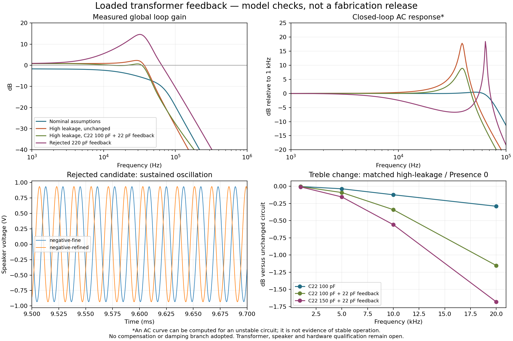

# Loaded feedback-winding qualification

Owner: electric integration. Task: T04 continuation, 24 November 2026.

## Task card

Inputs: checkpoint `9d69db3`, the unchanged native output/Presence circuit, generic tube models, and the independent magnetic-parameter fixture. Outputs: a reciprocal tapped-secondary model, validated two-injection loop measurement, bounded response/treble comparisons and transient checks. Done condition for this pass: demonstrate the probe against analytic controls and an independent port calculation; quantify loading and reject unstable candidates without silently changing the native circuit. Actual transformer parameters, core behavior, speaker impedance and physical qualification remain external dependencies. Estimated scope: one engineering iteration. Drill clearance stays deferred until November 25.

The previous ideal feedback source prevents current drawn by the feedback network from loading the transformer. This experiment replaces it with two series-aiding, mutually coupled secondary sections and explicit copper resistance. Their turns sum to the 8-ohm winding and the lower section provides the nominal 4-ohm tap. The resistance split assumes equal wire gauge and proportional winding length. This is a generic three-terminal topology, **not a model of an unselected commercial transformer or the multi-secondary Hammond hookup**.

## Measurement basis

Use two AC injections at the same closed-loop probe: a series voltage and a shunt current, one at a time, with the original DC connection maintained. Compute the bilateral return ratio using Tian et al., equation 30. Validate against a separate two-port admittance calculation and analytic unilateral/bilateral circuits with deliberately varied loading. Assess only the global output/Presence loop; this probe does not prove stability of every internal tube loop.

Sources: [Tian et al., primary paper](https://kenkundert.com/docs/cd2001-01.pdf), equations 20–30; [Analog Devices implementation](https://ez.analog.com/ez-blogs/b/engineerzone-spotlight/posts/dual-injection-done-right-tian-s-loop-gain-method-in-ltspice-part-6-of-7). The source equations are adapted to the stated probe polarities and independently checked, not copied as an assumed sign convention.

## Results and disposition

The probe passes 18 analytic loading/reverse-transmission controls. Seven independent transformer-terminal checks verify the emitted winding's ratio, impedance and DC paths. All 87 AC cases complete: 27 magnetic corners, 36 compensation/Presence cases, six load cases and 18 speaker-output series-RC damping trials. The maximum probe DC displacement is 9.09e-13 V; two independent admittance cross-checks differ by at most 1.11e-7 in relative return ratio. The [312-check audit](results/loaded-feedback-audit.json) passes evidence integrity and expected positive/negative controls. It is not an amplifier acceptance result.

The triage screen asks for at least 10 dB gain margin, at least 45 degrees angular distance from the negative-real axis at each unity crossing, and no more than 3 dB HF peaking. These are engineering screening thresholds, not user tonal requirements or a complete Nyquist proof; open-loop right-half-plane poles and internal tube loops are not certified. Forty-five cases pass this screen and 42 fail it.

| Case | Minimum gain margin | HF peak | Disposition |
|---|---:|---:|---|
| Reference 40 H / 20 mH / 250 pF, Presence 0.5 | 14.075 dB | 0.454 dB | Passes bounded screen |
| 80 mH leakage, Presence 0, unchanged C22 | 2.802 dB | 17.811 dB | Inadequate margin and peaking |
| Same corner, C22=100 pF and feedback cap=22 pF | 7.729 dB | 8.927 dB | Reject |
| Same corner, C22=100 pF and feedback cap=47 pF | 13.187 dB | 5.885 dB | Reject; angular distance also only 42.495 degrees |
| Same corner, C22=150 pF and feedback cap=22 pF | 8.076 dB | 7.201 dB | Reject |
| Same corner, feedback cap=220 pF | -0.722 dB | 18.451 dB | Unstable negative control |
| Same corner, output series 8.2 ohm / 220 nF shunt | 0.833 dB | 27.386 dB | Worse than baseline; reject |

All 18 tested output damping branches fail the worst-case screen. This rejects these particular values and topology in this model, not every possible damping network. No native compensation, damping branch or functional-block change is adopted. Transformer selection/characterization remains the next electrical dependency.

Accounting for physical feedback-winding loading changes the matched model's sampled 1/5/10/20 kHz gain by at most 0.000691 dB. It does not explain away the large leakage-dependent resonance. The larger compensation options still carry treble tradeoffs recorded in [the matched comparison](feedback-review.md); acoustic-use priority remains explicit. These results do not include the eventual speaker, pickup or cabinet response.

## Transient cross-check and metric correction

Four 10 ms local 50 kHz burst cases complete. Relative to the independently calculated operating point, nominal and high-leakage tails fall to 0.253 and 0.364 microvolts. The rejected 220 pF feedback candidate sustains 0.9354 and 0.9365 V late peaks at maximum timesteps of 156.25 and 78.125 ns, a 0.114% amplitude difference. Waveform phase alignment is not part of that comparison. A decaying small burst does not overrule poor AC margin or establish startup, clipping, core saturation or supply/fault acceptance.

The initial absolute-voltage decay metric incorrectly counted approximately 89 microvolts of winding DC offset as ringing. The metric was corrected to subtract the operating point; the 10-microvolt limit, circuit and simulation parameters were unchanged. Both raw and corrected results remain in [the receipt](results/loaded-burst-summary.json).



## Reproduction and handoff

Run with the project Python environment and its existing ngspice shared-library adapter, from the repository root:

```sh
python3 engineering/whole-amp/effects-loop/tools/check_loop_probe.py
python3 engineering/whole-amp/effects-loop/tools/check_loaded_winding.py
python3 engineering/whole-amp/effects-loop/tools/sweep_loaded_feedback.py
python3 engineering/whole-amp/effects-loop/tools/check_loaded_transient.py
python3 engineering/whole-amp/effects-loop/tools/audit_loaded_feedback.py
python3 engineering/whole-amp/effects-loop/tools/plot_loaded_feedback.py
```

Native circuit, schematics and all four boards remain byte-identical to checkpoint `9d69db3`. Next obtain/select credible China-source transformer parameters, correlate the loaded model, then qualify compensation across actual load/supply/control corners before finalizing RETURN and routing. [Supplier screening](../../component-selection/evidence/output-transformer-screen-2026-11-24.md) remains research, not an order. The independent [capacitor fit finding](../pcb-measured-r/review/fc6136-fit-review.md) must be resolved before populated-board placement. Rear removal and actual drill access remain mechanical release gates; the latter stays deferred to November 25.
