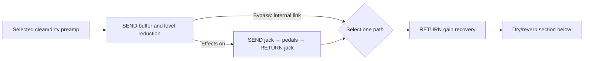
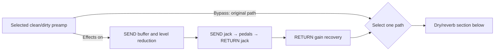
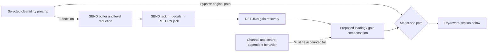
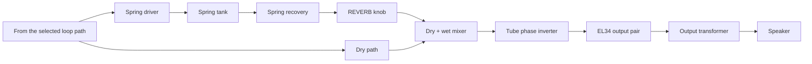

# Three effects-loop behavior options

Owner: electric integration. User request FB-121,25 November2026. These are functional diagrams for choosing behavior, not selected components or manufacturing schematics. Option 1 was approved on 25 November 2026 (FB-123; DEC-016). Each option keeps the effects loop before the spring-reverb split, preserves the clean/dirty preamps, and retains constant dry with adjustable wet. Power supply and switching-control wiring are omitted from these audio-path diagrams.

Solid arrows show signal paths. A bypass/on selector chooses ONE input; it does not mix the two. The SEND and RETURN circuitry can use discrete transistors; a block labeled buffer does not select an amplifier IC or add a tube.

## 1. Consistent buffered path — recommended direction

SEND and RETURN circuitry stay in the signal path in both modes. An internal link replaces the pedals during bypass. Recalibrate the reverb mixer for this known source impedance; the mixer sees the same output stage in both modes. This avoids an impedance jump when switching, although pedals can intentionally change level/tone. It changes the former passive loading behavior. Device selection, sound, noise, clean/overload headroom and power-failure behavior remain to qualify.

## 2. Original passive bypass, buffered effects path

In bypass the original preamp drives the mixer directly. With effects on, RETURN circuitry drives it. The changed source impedance can change dry gain, spring excitation and wet level even with neutral pedals. Reverb readjustment may be needed; the bare unity-buffer comparison also changes dry gain, so an overall loop-level calibration is part of this option. Any SEND tap left connected during bypass must have its loading qualified or be disconnected. “Original bypass” is the target behavior, not an already-proven implementation.

## 3. Preserve original behavior more closely, with compensation

Compensation would have to recreate the original source behavior across channel, master/tone settings and frequency. The dashed line is a requirement, not a selected electronic controller or sensor. This circuit has not been solved or costed. One fixed resistor or fixed wet-gain trim cannot meet the current preservation target across the measured settings. It may require more circuitry, calibration and fault testing; feasibility is not promised.

## Shared dry/reverb and output section — all three options

The REVERB knob changes the wet contribution; it is not a dry/wet crossfade. External effects are applied before the signal excites the spring in every option. Main audio, power and reverb board ownership stays intact; these diagrams do not settle their physical placement.

Evidence: [port-envelope review](return-port-review.md), results/return-port-audit.json. Option 1 is now selected; see brain/records/DEC-016-buffered-loop-expression-selector.md. The generated results/signal-path-options.png is the historical comparison shown before approval; its footer is superseded.
