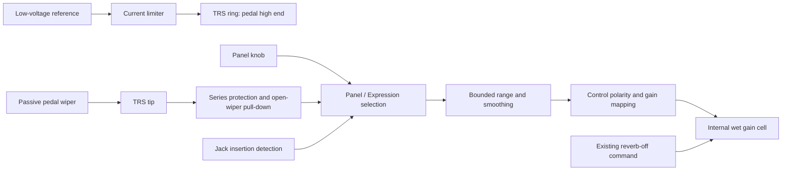

# Protected expression port — implementation proposal

Owner: expression-control. Inputs: requirements.md, DEC-016, the manufacturer-verified Hotone 10k tip-wiper interface, and settled-bias-review.md. Outputs: control-only jack/harness interface and acceptance cases for the next circuit revision. Status: proposed; no PCB or purchase release.

## Signal and ownership

The reverb board owns the reference limiter, input protection, control selection, smoothing and wet gain cell. The main audio board retains the constant dry path. The power board supplies the declared low-voltage rails; protective earth remains independent. The expression jack mounts on the removable metal chassis, not the removable wooden back. A panel-mounted solder-lug version would use insulated wire and a keyed board connector; a PCB-pin version must be supported by the chassis and the reverb board without requiring a fourth board.

TRS sleeve is the control return. The port never carries recovered wet audio. Existing footswitch and expression connections remain distinct. The present PNP candidate needs inverse control voltage; a heel-low pedal cannot be wired to it directly. Either an internal inversion stage or a qualified positive-polarity bias circuit is required before capture.

## Operating states

| State | Selected control | Required handling |
|---|---|---|
| PANEL, cable present or absent | Panel knob | Pedal movement has no wet-level effect |
| EXPRESSION, no plug | Panel knob | Restore through the same smoothing path |
| EXPRESSION, valid plug | Pedal | Heel dry, toe calibrated maximum wet |
| Plugged, open wiper | Dry request | Local pull-down; do not mistake for unplug |
| Plugged, failed supply/return loop | Dry request | Qualify fault detector and insertion sequencing |
| Reverb off | Wet muted | Existing mute overrides every selection |

A standard three-normal-contact TRS jack can provide a sleeve-normal insertion indication, while the tip normal can provide panel fallback. Exact pin numbers, normal-contact sequencing and contact leakage must be verified from the chosen part. Debounce alone cannot control a level jump: selection must precede the common slew/smoothing stage. The desired smoothing interval needs both electrical and listening checks; no click-free claim is made here.

## Preliminary electrical budget

A proposed 5V reference feeding a 10k pedal through 1k limits a hard ring-to-sleeve short to 5mA and dissipates 25mW in that resistor. Its unloaded wiper at toe reaches 4.545V, not 5V. With pedal resistance 8–12k, that becomes 4.444–4.615V. These are nominal divider calculations, not qualified part tolerances or an implemented protection circuit. Input pull-down, clamp leakage, cable resistance and the reference tolerance must enter the final range calculation. The panel control needs equivalent calibrated endpoints; matching the old 100k audio pot is not required.

## Fault boundary that must remain explicit

A short between tip and ring can be electrically identical to a valid toe-down position on an ordinary three-wire passive pedal. Therefore a circuit cannot promise to detect every cable fault from these three terminals alone. Bound the permitted wet gain and its rate of change so this fault cannot produce an unbounded or instantaneous jump. If guaranteed dry response to that particular fault is required, the pedal interface must change (for example additional identification/contact information); that is a separate user decision, not an implicit redesign.

Insertion, partial insertion, mono-plug insertion, each open/short, powered-off reference backfeed, supply sequencing and existing mute priority remain mandatory circuit tests. A ring-voltage window can catch several faults but does not remove the tip/ring ambiguity. No detector threshold is selected yet.

## Jack candidates and procurement

Neutrik NMJ6HCD2 has PCB pins and three normal contacts; the distinct NMJ6HC-S has solder lugs. Do not substitute the -SM or -RM variants, whose make-contact behavior differs. Manufacturer references: [NMJ6HCD2](https://www.neutrik.com/en/product/nmj6hcd2), [contact circuits](https://www.neutrik.com/media/8557/download/jacks---circuits.pdf?v=1), [solder-lug version](https://www.neutrik.com/en/product/nmj6hc-s.pdf). Exact drilling, body/pin tolerance and assembly stack still require the selected drawing and PCB checks.

On November25, the public [international LCSC listing](https://www.lcsc.com/product-detail/Audio-Video-Connectors_Neutrik_NMJ6HCD2_Neutrik-NMJ6HCD2_C368502.html) showed C368502, stock1457, MOQ1 and USD3.3596 at quantity1. This is a search-index/public listing observation, not a live quote or domestic Shanghai-delivery confirmation. Domestic LCSC search returned an access challenge; Mouser China and DigiKey China access did not establish stock/delivery. Searches did not establish a Taobao/Pinduoduo exact SKU. Keep domestic procurement open rather than converting an international listing into a China purchase claim.

Human check: with a real pedal and cable, confirm wiring and heel/toe direction, then deliberately operate the toggle with knob and pedal at opposite ends and test unplug/replug while measuring the wet output. Do not purchase or fabricate from this proposal alone.

Drawing inspection: the retained [NMJ6HCD2 manufacturer drawing](references/Neutrik-NMJ6HCD2-drawing.pdf), modified February23,2021, specifies nominal **1.4mm round PCB holes** and an **11.4mm circular panel opening**. The PCB pattern is explicitly viewed from the component side. Pin rows are T/R/S and TN/RN/SN, separated16.2mm; the old distributor catalogue's generic1.5mm recommendation must not replace this exact drawing. This is a candidate geometry observation, not finished-hole tolerance or fit approval. See references/jack-drawing-observation.json.

## Domestic source follow-up — 25 November 2026

The exact [NMJ6HCD2 / C368502 domestic listing](https://item.szlcsc.com/342489.html) is now accessible. Its retained product record reports raw stock 369, minimum buy 1 and ratio 1. See results/jack-domestic-source-observation.json for the distinct stock/unit fields. This supersedes the earlier inability to establish a domestic listing; it does not qualify the board-to-panel stack or connector sequencing. [LCSC shipping policy](https://www.szlcsc.com/help/202.html) describes domestic couriers and checkout-dependent freight. A Shanghai purchasing route is plausible from that policy, but exact address-specific checkout, delivered cost and date remain unverified. No purchase or supplier contact.
