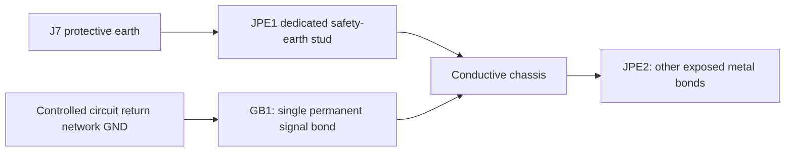

# Explicit earth/signal-ground contract — 24 November 2026

Owner: electrical integration. Task T03. **Logical schematic check complete; physical bonding and manufacture remain unqualified.** Neither active schematic topology nor PCB copper was changed.

## Fault and repair

The circuit contract assigns J7.3, JPE1.1 and JPE2.1 to PE, while its other ground endpoints use GND. The native heater/earth sheet already connects those groups with one visible wire. The former checker silently rewrote every PE name to GND before comparing pins. It therefore did not prove that the intended bond existed or that there was only one native interconnection.

`../grounding-contract.json` now declares GB1 explicitly: one permanent signal-common-to-chassis bond, separate from the dedicated mains safety-earth fastening. It identifies the existing native wire by UUID and endpoints. `../tools/check_grounding.py` exports a fresh baseline and, in temporary copies only, removes that wire and exports a second netlist. The baseline must match the contract with this one declared bond; the cut copy must match all original separate GND/PE endpoint partitions exactly. Missing PE terminals, unrelated shorts/splits or another drawn GND/PE bridge fail the test.

`../tools/grounding_contract.py` permits the equivalence only with a passing receipt whose contract, circuit, every schematic sheet and native XML hashes still match. The native checker and PCB hole/pad audit now call this gate. There is no unconditional PE alias. Future schematic changes require fresh proof. This is a native connectivity test, not a claim that a diagram contains every real chassis contact.

## Intended assembly topology

Safety earth must have its direct, permanent route from the inlet to the chassis. Circuit-return currents need controlled wiring rather than using the chassis as a common current-carrying conductor. This approach follows the distinction made in [Aiken's grounding guidance](https://www.aikenamps.com/index.php/grounding) and [Blencowe's grounding chapter](https://www.valvewizard.co.uk/Grounding.pdf). Exact physical placement and fault-current qualification remain project-specific work.

Project application: keep reservoir charging return (T1 CT, C30 negative and associated rectifier loop) local to the power section; keep output/speaker return current away from quiet input/reverb recovery returns. Screen/preamp filter returns, bias/reference, logic/relay returns and reverb loops need the populated T09/T12/T14 routing review. A single logical GND does not authorize arbitrary plane or harness connections. No circuit-wide net split or new copper pour was applied here.

Insulate signal jacks/mounts where they would create additional GND-to-chassis contacts. The tank's output sleeve is bonded to its case; mounting/cable arrangements must not create a second chassis bond. The declared topology does not prove actual jack insulation, standoff isolation or tank mounting. Include both new panel-finish alternatives and any conductive trim in the exposed-metal inventory. Permanent PE is independent of the new mains-voltage selector in every position. Rear wooden cover removal remains independent of the chassis and its earth connections.

## Results and retained limits

[Native receipt](grounding-audit.json): eight checks pass, including the negative cut-wire control and unchanged active schematic/board hashes. Full native check: 231 components, 599 connected-pin mappings and 25 modeled R/C value/endpoint checks pass. [PCB receipt](../../pcb-measured-r/review/grounding-board-audit.json): all four board pad contracts and symbol paths pass; contract/native endpoint-group errors are zero with the proven GB1 contract. Local auto-generated net-label spelling differences remain; those are not endpoint partition errors.

No new ERC/DRC claim: CAD is byte-identical to the baseline. The existing native GND/PE label-merge warning is consistent with the declared direct bond and remains visible; it is not hidden by a rule exclusion. No physical continuity, fault-current, insulation, crimp or thermal test has occurred. Exact conductors/terminals/fasteners, contact preparation, all metal-part bonds and assembled noise/return routing remain gates. Keep all fabrication holds.

Next: T04, approximately 25 W target and full-amplifier/RETURN envelope, now including the adopted selectable mains requirement. Use ideal-transformer simulations only within their stated scope; do not turn clipped-waveform RMS or a transformer's label into an amp rating.
